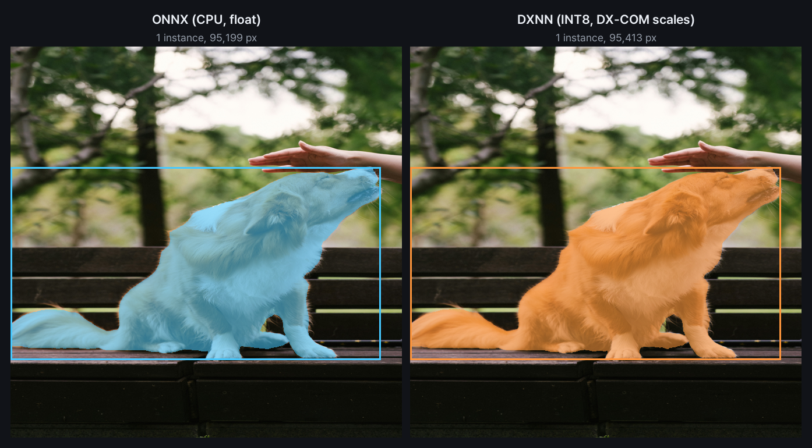

# sam3.dxnn

SAM3's vision encoder compiled for the DeepX DX-M1 NPU.

Weights: [huggingface.co/PleahMaCaka/sam3.dxnn](https://huggingface.co/PleahMaCaka/sam3.dxnn)

## Build

```sh
nix develop
just build
```

Writes four `.dxnn` segments and their quantization checkpoints to `build/`.

## Result

Prompt `dog`, 672 px, decoder in float on the CPU for both paths.



| | float | INT8 |
| --- | --- | --- |
| instances | 1 | 1 |
| mask px | 95,199 | 95,413 |
| score | 0.962 | 0.967 |
| mask IoU | | 0.9938 |

The INT8 side runs the `.qxnn` graphs with `fp32` off on `ActQuant`, `QConv` and
`QGemm`, so activations and weights both round on DX-COM's own calibrated
scales. All three ship bypassed, and a run that leaves any of them on measures
float against float.

`just verify` checks the float side against stock SAM3 at the same size: cosine
0.999969, mask IoU 0.9999. The RoPE rewrite and the BGR swap cost nothing.

`just bench` prints the encoder error as it accumulates. Each segment is fine on
its own; the error compounds down the chain.

| Segment | isolated QSNR | cumulative QSNR | cumulative cosine |
| --- | --- | --- | --- |
| 0 | 13.61 dB | 11.50 dB | 0.9673 |
| 1 | 13.90 dB | 7.27 dB | 0.9074 |
| 2 | 18.83 dB | 6.28 dB | 0.8780 |
| 3 | 14.94 dB | 5.14 dB | 0.8472 |

Isolated is `quant_diagnosis/diagnosis_report.html`, which feeds each segment a
float input. Cumulative chains the quantized output forward, which is what the
device would do. The mask survives it: the decoder absorbs an encoder that has
drifted to cosine 0.847.

Running the `.dxnn` on hardware is untested: no card.

## Layout

All 32 layers run on the NPU. The only CPU node is the patch reorder in front of
the first segment.

| Segment | Layers | NPU nodes | CPU nodes |
| --- | --- | --- | --- |
| 0 | 0-7 | 559 | 1 |
| 1 | 8-15 | 551 | 0 |
| 2 | 16-23 | 551 | 0 |
| 3 | 24-31 | 552 | 0 |

## Constraints

Input size follows the patch grid, `size / 14`. The grid squared must stay at or
under 4080 or global attention's `Softmax` falls to the CPU, and the grid must be a
multiple of the window size 24 or padding produces a tensor that fails codegen.
Grid 48, so 672 px, satisfies both.

Segments are 8 layers because register-map generation exhausts host memory beyond
that, and each is exported as its own graph taking the previous hidden state, which
is what keeps the earlier layers off the CPU.

SAM3's pairwise rotary embedding is rewritten as the half-split form by permuting
each head's `q_proj` and `k_proj` rows, and `Neg` becomes `Mul(-1)`. Both are exact.
The graph takes BGR in the 0-255 domain to match DX-COM's calibration loader.

Photo by [Alvan Nee](https://unsplash.com/photos/0WJBoHc_EWo) on Unsplash.
